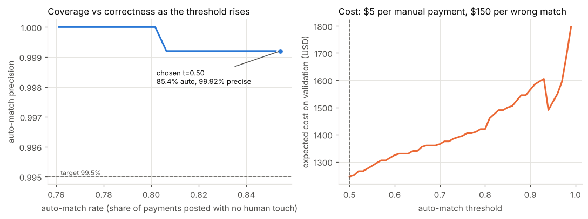
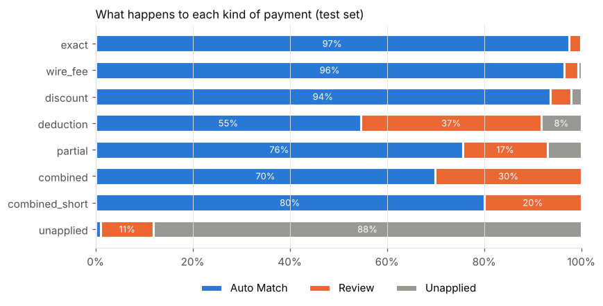

# Cash Application: Matching Payments to Invoices with ML

An end-to-end ML project that automates **cash application**, the accounts-receivable job of working out which open invoice(s) each incoming bank payment pays. It covers the full lifecycle: a realistic messy dataset, candidate generation, a gradient-boosted match scorer, a cost-based auto-match / review / unapplied decision layer, thorough evaluation against a rules baseline, a FastAPI service that posts cash against a live ledger, Docker, CI, and monitoring that uses analyst feedback as labels.

Everything runs on a laptop with free tools. No AWS account is needed; the last section shows how it maps to AWS.

## Why it matters

When a payment can't be matched it sits as **unapplied cash**. The customer looks overdue when they've paid, collectors chase the wrong people, credit holds hit good customers, and DSO is overstated at month-end. Most ERPs ship matching rules (exact invoice number + exact amount) that handle the easy cases and leave the rest to analysts, typically 5 to 10 minutes per payment.

On the held-out test period (Nov 2025 onward, 2,190 payments):

| | Rules engine | **ML matcher** |
|---|---|---|
| Payments auto-matched (no human touch) | 60.6 % | **86.2 %** |
| Precision of auto-matches (exact invoice set right) | 100 % | **99.6 %** (7 errors) |
| Sent to an analyst (review + unapplied) | 39.4 % | **13.8 %** |
| Review items where the first suggestion is right | n/a | **86.5 %** |
| Analyst hours a year at 50,000 payments (6 min each) | 1,972 | **691** |

So the ML matcher cuts the manual queue by about two thirds (**~1,280 analyst hours a year** at 50k payments) and gives analysts a ranked suggestion for most of what's left. The cost is 7 wrong auto-matches out of ~1,890, which the threshold choice prices in explicitly (below).

## Project roadmap

| Step | What it does | Status |
|------|--------------|--------|
| 1. Data | Customers, invoices, bank payments with messy names and remittance text, ground-truth links | ✅ |
| 2. Candidates | Shortlist open invoices per payment by reference, fuzzy name and amount (99.6 % recall) | ✅ |
| 3. Match scoring | 22 pair features; logistic regression vs gradient boosting vs ERP rules | ✅ |
| 4. Decisions + evaluation | Auto-match / review / unapplied, cost-based threshold, results by payment type, error analysis | ✅ |
| 5. Deploy | FastAPI with a live ledger, review queue and feedback; Docker; GitHub Actions | ✅ |
| 6. Monitor | Decision mix, PSI drift, audited precision from analyst feedback, bank-format-change simulation | ✅ |

## Quick start

```bash
python -m venv .venv
source .venv/bin/activate          # Windows: .venv\Scripts\activate
cd cash-application
pip install -r requirements.txt

python src/generate_data.py --out data           # 320 customers, 10,565 invoices, 8,549 payments
python src/train.py                              # ~2 min: builds 200k candidate pairs, trains, picks threshold
python src/evaluate.py                           # plots and tables in results/
python src/make_ledger_snapshot.py               # ledger/ the API starts from
python monitoring/make_reference.py              # monitoring/reference.csv
pytest -q                                        # 14 tests
uvicorn api.app:app --reload                     # http://127.0.0.1:8000/docs
```

The trained model, ledger snapshot and monitoring reference are committed, so `pytest` and the API work straight after `pip install`.

Or read the notebooks, which are saved with outputs:

| Notebook | Covers |
|---|---|
| `notebooks/01_data_exploration.ipynb` | Payment types, messy names, look-alike customers, remittance text, timing, ambiguous amounts |
| `notebooks/02_train_evaluate.ipynb` | Candidate recall, features, model comparison, threshold, test results, calibration, importance, error analysis, business impact |
| `notebooks/03_deploy_and_monitor.ipynb` | Calling the API, a day's bank file, review queue, normal vs shifted traffic, monitoring report |

## Project structure

```
├── api/app.py                   # FastAPI: /match, /match_batch, /review_queue, /feedback, /open_invoices, /stats, /health
├── data/                        # generated CSVs (git-ignored, recreate with the script)
├── ledger/                      # open-invoice snapshot + customer master the API starts from
├── models/
│   ├── match_model.joblib       # gradient-boosted pair scorer
│   └── model_meta.json          # features, thresholds, test metrics
├── monitoring/
│   ├── make_reference.py        # validation-period snapshot of signals and decisions
│   ├── monitor.py               # decision mix, PSI / KS drift, audited precision alerts
│   ├── reference.csv
│   └── simulate_traffic.py      # replays the test period (normal or bank-format-change) with simulated analysts
├── notebooks/                   # 01 data, 02 train + evaluate, 03 deploy + monitor
├── results/                     # plots and metric tables from evaluate.py
├── src/
│   ├── generate_data.py         # synthetic AR dataset
│   ├── text.py                  # name normalisation, fuzzy similarity, reference extraction
│   ├── candidates.py            # Ledger: open invoices on a date, candidate generation, posting cash
│   ├── features.py              # pair features incl. subset-sum for combined payments
│   ├── decide.py                # decision layer, reconciliation rules, cost-based threshold
│   ├── train.py                 # pairs, models, rules baseline, threshold, saves the winner
│   ├── evaluate.py              # plots, by-type metrics, importance, error list, business impact
│   ├── inference.py             # Matcher class used by the API and batch scoring
│   ├── make_ledger_snapshot.py  # freezes the ledger for the API
│   └── predict.py               # batch-match a CSV bank file
├── tests/                       # text, matching, decision and API tests
├── Dockerfile                   # CI: ../.github/workflows/cash-app-ci.yml
└── requirements.txt, requirements-api.txt
```

---

## Step 1: Data

Real remittance data is confidential, so `src/generate_data.py` builds a reproducible AR history for 320 B2B customers over 2025: invoices from each customer at its own rate and size, then payments that follow customer-specific habits (average lateness, how often they batch invoices, payment terms). The four outputs mirror what you'd pull from an ERP and a bank feed:

| File | Rows | Columns |
|---|---|---|
| `customers.csv` | 320 | customer_id, customer_name |
| `invoices.csv` | 10,565 | invoice_number, customer_id, po_number, amount, issue_date, due_date |
| `payments.csv` | 8,549 | payment_id, payment_date, amount, payer_name, remittance_text (+ payment_type, true_customer_id for analysis only) |
| `matches.csv` | 10,640 | payment_id, invoice_number (ground truth) |

What makes it hard, on purpose:

| Problem | Share | Example |
|---|---|---|
| Combined payment (several invoices) | 13.5 % | `INV100067/INV-100073/INV100138/100252/...` for 5 invoices |
| Part-payment (invoice paid in two parts) | 9.1 % | 40 % now, the rest a month later |
| Short-paid: wire fee / 2 % discount / deduction | 6.2 / 4.5 / 4.2 % | 25 short of the invoice after a bank fee |
| No invoice at all (prepayment, unknown payer) | 3.8 % | `ADVANCE PMT` |
| No usable reference in the text | 20.6 % | `THANK YOU`, `AP PAYMENT RUN`, `SEE EMAIL` |
| Reference is only a 4-digit fragment / PO number | 12 % / 7 % | `4519`, `PO 4091761` |
| Invoice number with transposed digits | ~1 in 6 references | `INV 018307` |
| Payer name differs from the customer master | 80 % | `ACME IND SUPP`, `DELTA FOODS DISTRI`, `PAYPAL *ACME` |
| Round, repeated invoice amounts | 15 % of invoices | 500 / 1,000 / 2,500 appear 300+ times each |

## Step 2: Candidate generation

Scoring every payment against every open invoice is slow and noisy, so `Ledger.candidates()` keeps an invoice that was **open on the payment date** if any cheap, high-recall signal fires:

1. **Reference**: the remittance contains its 6-digit number, its last 4 digits, or its PO number.
2. **Name**: its customer is in the top 3 fuzzy matches for the payer name (after upper-casing, dropping legal suffixes and bank noise, expanding abbreviations like `IND → INDUSTRIAL`; score = max of token-set and partial ratio, RapidFuzz).
3. **Amount**: its open balance equals the payment within 0.2 %.

The ledger knows which invoices were open on each date (an invoice closes when its last payment lands, and part-payments reduce the open balance), so a payment can't match an invoice that was already paid.

**Result:** ~24 candidates per payment (median 17), and **99.1 % to 99.6 %** of true payment-invoice links survive across train, validation and test. The few misses are combined payments where an invoice is older than the 240-day window or the payer is unrecognisable.

## Step 3: Match scoring

Each (payment, candidate invoice) pair gets 22 features (`src/features.py`):

| Group | Features |
|---|---|
| Reference | exact number found, 4-digit fragment, PO found, refs found in text, other refs to the same customer, text empty |
| Name | similarity to this invoice's customer, gap to the best-matching customer |
| Amount | payment / open balance, abs log ratio, exact, fee-like (short by up to 50), discount-like (98 %), partial-like, **subset-sum match** and its size, rank of amount closeness |
| Timing | days from due date, days since issue, age rank among the customer's open invoices |
| Context | candidates for this payment, open candidates of this customer |

The **subset-sum** feature is what makes combined payments learnable: for each customer among the candidates, it searches combinations of 2 to 5 open invoices whose total equals the payment (or equals it after a 2 % discount) and flags the members.

Models, trained on Jan to Aug and compared on Sep to Oct (time split, no future leakage):

| Model | Pair PR-AUC | Auto-match rate | Auto-match precision | Review + unapplied |
|---|---|---|---|---|
| Rules (exact number + exact amount, or one exact amount for a clearly named customer) | n/a | 60.4 % | 100 % | 39.6 % |
| Logistic regression | 0.969 | 79.4 % | 100 % | 20.6 % |
| **Histogram gradient boosting** | **0.989** | **85.4 %** | 99.9 % | 14.6 % |

Gradient boosting wins because the signals interact: an exact amount means a lot when the name matches and little when it's a round 1,000 from a different customer.

## Step 4: Decisions and evaluation

`src/decide.py` turns pair scores into **one decision per payment**:

- Invoices with match probability ≥ 0.5 are the proposed set.
- **AUTO_MATCH** only if the lowest probability in the set clears the auto threshold **and** the amounts reconcile: exact, short by a wire fee (≤ 50), a 2 % early-pay discount, or a part-payment of a single invoice whose number is quoted exactly.
- **REVIEW** otherwise, with the top 3 ranked suggestions; **UNAPPLIED** when nothing scores above 0.15.

The reconciliation check is a deliberate guardrail: a confident match that leaves a 12 % gap is usually a deduction that needs a reason code, so a person should see it.

**Choosing the threshold.** On validation, each candidate threshold is costed at about \$5 per manual payment and \$150 per wrong auto-match (reverse, re-apply, possibly a wrong dunning letter). The cheapest threshold that keeps precision at or above 99.5 % is chosen. Here that's the floor (0.50): the reconciliation check already removes the risky matches, so raising the threshold only adds manual work (see `results/threshold_tradeoff.png`). Change `MANUAL_COST` / `WRONG_COST` in `decide.py` to your own numbers.



**Test results by payment type:**

| Payment type | Payments | Auto-matched | Precision | Review | Unapplied |
|---|---|---|---|---|---|
| exact | 1,309 | 97.4 % | 100 % | 2.4 % | 0.2 % |
| wire fee | 139 | 96.4 % | 99.3 % | 2.9 % | 0.7 % |
| discount | 94 | 93.6 % | 100 % | 4.3 % | 2.1 % |
| deduction | 97 | 54.6 % | 100 % | 37.1 % | 8.2 % |
| partial | 201 | 75.6 % | 99.3 % | 17.4 % | 7.0 % |
| combined | 223 | 70.0 % | 97.4 % | 30.0 % | 0 % |
| combined + discount | 35 | 80.0 % | 100 % | 20.0 % | 0 % |
| no invoice (unapplied) | 92 | 1.1 % | n/a | 10.9 % | 88.0 % |



Also in `results/`: pair-level precision-recall vs name-only and reference-only scores (`pr_curve.png`), calibration (`calibration.png`), and permutation importance (`feature_importance.png`). The model leans most on the invoice number in the text and on whether this customer is the best name match, followed by amount closeness and subset-sum membership.

**Error analysis.** All 7 wrong auto-matches are in `results/auto_match_errors.csv`, in three patterns: a different subset of a customer's open invoices that also adds up to a combined payment (4), a no-reference payment matched to an invoice within the fee tolerance (2), and a typo'd invoice number that happens to be another real open invoice (1). Fixes worth trying are in notebook 02.

## Step 5: Deploy

`api/app.py` (FastAPI) loads the model and the ledger snapshot and **posts cash as it goes**: when a payment is auto-matched the invoice is closed (or its balance reduced for a part-payment), so the next payment can't match it again.

| Endpoint | Purpose |
|---|---|
| `POST /match` | one payment → decision, invoices, confidence, reconciliation type, ranked suggestions |
| `POST /match_batch` | a day's bank file (up to 1,000), processed in date order |
| `GET /review_queue` | payments waiting for an analyst, biggest cash first |
| `POST /feedback` | analyst's resolution or an audit of an auto-match; posts the cash and logs the label |
| `GET /open_invoices/{customer_id}` | the customer's open items |
| `GET /stats` | decision mix, p95 latency, audited auto-match precision, suggestion accuracy |

```bash
curl -X POST localhost:8000/match -H 'Content-Type: application/json' -d '{
  "payment_id": "BANK-0042", "payment_date": "2025-11-04", "amount": 746.05,
  "payer_name": "GOLDEN GATE CHEM", "remittance_text": "PMT 0139"}'
# -> {"decision": "AUTO_MATCH", "invoices": ["INV-100139"], "confidence": 0.9907, "reconciliation": "fee", ...}
```

That payment quoted only 4 digits, used a truncated payer name and was 25 short (a wire fee), and it was still matched to the right invoice.

Docker and CI:

```bash
docker build -t cash-app-api .
docker run -p 8000:8000 cash-app-api
```

`.github/workflows/cash-app-ci.yml` (at the repo root, only triggered by changes to this folder) runs the tests, regenerates the data and retrains from scratch, fails if test auto-match rate drops below 75 % or precision below 99 %, then builds the image and smoke-tests `/health` and `/match`. Latency is about 16 ms per payment (p95, in-process).

## Step 6: Monitor

Cash application has an advantage most ML systems don't: **labels arrive within days**, because every review item an analyst resolves, and every audited auto-match, says whether the model was right. `monitoring/monitor.py` compares the API logs with the validation-period reference on three fronts:

1. **Decision mix**: alert if the auto-match rate falls more than 5 points (lost savings).
2. **Drift (PSI)** on amount, confidence, candidates per payment, best name score, references found and the share of payments with no usable text.
3. **Labelled quality**: audited auto-match precision must stay above 99.5 %; review top-suggestion accuracy is tracked.

`simulate_traffic.py` replays 800 test-period payments day by day, with simulated analysts who resolve every review item and audit 10 % of auto-matches. In the **shifted** run a bank silently starts truncating remittance text to 8 characters and payer names to 12:

| Signal | Reference | Normal | Shifted |
|---|---|---|---|
| Auto-match rate | 85.4 % | 85.5 % | **72.9 %** ⚠ |
| Payments with no usable reference | 22 % | 22 % | **87 %** ⚠ (PSI 2.06) |
| Mean confidence | 0.91 | 0.92 | **0.83** ⚠ (PSI 0.66) |
| Audited auto-match precision | | 100 % | 100 % |
| Review top suggestion right | | 88.8 % | 77.3 % |

The monitor raises five alerts on the shifted run and none on the normal one. Precision holds at 100 % because the decision layer degrades safely: it sends more to review instead of guessing. The fix is upstream (re-map the bank feed), not a retrain.

```bash
python monitoring/simulate_traffic.py --mode shifted --log-dir logs/shifted
python monitoring/monitor.py --current logs/shifted/matches.csv --feedback logs/shifted/feedback.csv
```

## How this maps to AWS

| Here | AWS equivalent |
|---|---|
| bank files + ERP extracts in `data/` | S3 landing bucket; bank statements (BAI2 / camt.053 / lockbox) parsed by a Lambda on upload |
| `train.py` | SageMaker Training job (scikit-learn container), tracked in SageMaker Experiments |
| `models/` | S3 + SageMaker Model Registry with an approval step |
| FastAPI + Docker | SageMaker real-time endpoint (bring your own container) for scoring, or ECS Fargate behind API Gateway |
| in-memory ledger | DynamoDB or Aurora table of open items, updated as cash is posted (and synced back to the ERP) |
| review queue + `/feedback` | Amazon Augmented AI (A2I) human review workflow, or a small internal UI on the same API |
| daily bank file through `/match_batch` | Step Functions: parse file → batch transform or endpoint → post auto-matches → push the rest to review |
| `logs/` | SageMaker Data Capture / Firehose to S3, queryable in Athena |
| `monitor.py` on a schedule | SageMaker Model Monitor (data quality + model quality with A2I labels), CloudWatch alarms to SNS |
| GitHub Actions retrain gate | SageMaker Pipelines with a condition step on auto-match rate and precision |

## Going to production

- **Ledger state**: the demo keeps the open-invoice ledger in memory (one worker). In production it lives in a database with row locking, so two payments can't claim the same invoice.
- **Real data**: swap `generate_data.py` for ERP and bank extracts with the same columns; the rest of the pipeline is unchanged. Retrain on a few months of analyst-resolved history.
- **Value limits**: route payments above a set amount to review regardless of score.
- **Deduction handling**: short payments that go to review could be pre-coded with a likely reason (pricing, damage, promotion) by a second model.
- **LLM assist**: remittance emails and PDF advices (`SEE EMAIL`) can be parsed by an LLM into invoice numbers before matching.

## Limitations

- The data is synthetic. The structure and messiness are modelled on how real lockbox and remittance data look, but real numbers will differ; the CI gate checks the pipeline, not real-world performance.
- Candidate generation caps the search (top 3 customers by name, invoices up to 240 days old, combinations of up to 5 invoices from up to 14 open items), so very large combined payments go to review.
- Historical "open on date" status assumes earlier payments were applied correctly.
